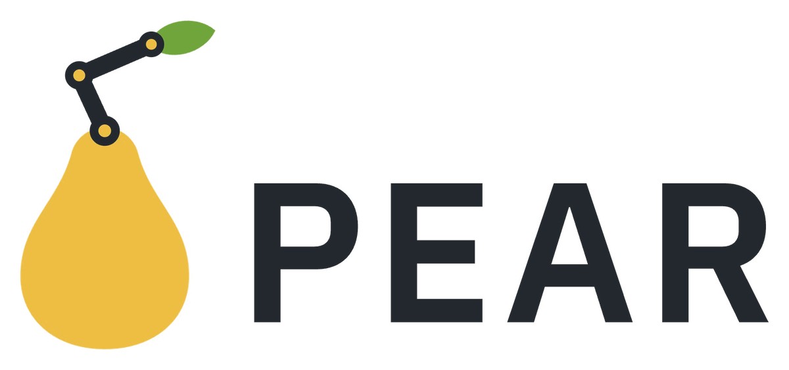

<p align="center">
  <picture>
    <source media="(prefers-color-scheme: dark)" srcset="docs/assets/pear_logo_dark.png">
    
  </picture>
</p>

<h3 align="center">
a Post-training Engine for Agentic Robotics
</h3>

<p align="center">
| <a href="https://mit-han-lab.github.io/pear-blog/"><b>Blog</b></a> | <a href="https://mit-han-lab.github.io/pear-blog/paper.pdf"><b>Paper</b></a> | <a href="https://huggingface.co/collections/mit-han-lab/pear"><b>Model</b></a> | <a href="docs/README.md"><b>Documentation</b></a> |
</p>

---

## About

PEAR is a post-training engine for agentic robotics: it trains reasoning models to natively use robots, with
reinforcement learning in simulation.

PEAR is the training infrastructure behind
[Training Reasoning Models in Simulation to Natively Use Real Robots](https://mit-han-lab.github.io/pear-blog/), where
an open 27B reasoning model learns to use real robots entirely in simulation, with zero demonstrations.

PEAR trains with:

- Fully asynchronous RL on [veRL](https://github.com/volcengine/verl)
- GRPO, dynamic sampling, and Score Centering
- FSDP and sequence parallelism for long-context training
- Memory-efficient training with gradient checkpointing and activation offloading
- Prefix caching across rounds, with [LMCache](https://github.com/LMCache/LMCache) offloading the KV cache to CPU
  memory
- Optimized kernels for H100, H200 and GB300
- Simulators on the same Ray cluster: MuJoCo on CPUs, Isaac Sim on GPUs

PEAR evaluates with:

- Robotic benchmarks: LIBERO, LIBERO-Plus, LIBERO-Pro, RoboDojo and RoboLab-120
- General benchmarks: nine reasoning, coding and vision benchmarks through [EvalScope](https://github.com/modelscope/evalscope)

PEAR deploys with:

- A [model server](examples/models/qwen3_8_27b_pear/deploy/README.md): vLLM server on one RTX 5090 or GB300, with decode megakernels
- A [robot station](examples/models/qwen3_8_27b_pear/deploy/README.md#drive-a-robot): the agent loop that drives a YAM or an SO-101 robot

## Getting Started

Install PEAR and everything a LIBERO run needs, on a GPU node:

```bash
git clone https://github.com/mit-han-lab/pear.git && cd pear
export WORK_DIR=<a directory every node sees>   # the model, the environments and the runs go here
bash scripts/install.sh libero_run              # installs the model, LIBERO and the training environment
```

Then start a Ray cluster and launch your first run:

- [Installation](docs/getting_started/installation.md)
- [Quick Start](docs/getting_started/quickstart.md)
- [Recipes](examples/README.md)

## Supported Models

| Model | Recipes |
| --- | --- |
| [Qwen3.8-27B](https://huggingface.co/Qwen/Qwen3.8-27B) | [train](examples/models/qwen3_8_27b_pear/train), [deploy](examples/models/qwen3_8_27b_pear/deploy) |

## Supported Environments

| Environment | Robot | Simulator | Used for |
| --- | --- | --- | --- |
| [LIBERO](https://github.com/Lifelong-Robot-Learning/LIBERO) | Franka | MuJoCo | training, evaluation |
| [LIBERO-Plus](https://github.com/sylvestf/LIBERO-plus) | Franka | MuJoCo | evaluation |
| [LIBERO-Pro](https://github.com/Zxy-MLlab/LIBERO-PRO) | Franka | MuJoCo | evaluation |
| [RoboDojo](https://arxiv.org/abs/2607.04434) | dual-arm ARX | Isaac Sim | training, evaluation |
| [RoboLab-120](https://github.com/NVlabs/RoboLab) | Franka with a Robotiq gripper | Isaac Sim | evaluation |

## Supported Embodiments for Deployment

| Robot | Arms | Used for |
| --- | --- | --- |
| [YAM](https://github.com/i2rt-robotics/i2rt) | two, with grippers | deployment |
| [SO-101](https://github.com/TheRobotStudio/SO-ARM100) | one, with a gripper | deployment |

## Supported Hardware

| Platform | Hardware |
| --- | --- |
| NVIDIA Blackwell | GB300, RTX 5090 (the model server) |
| NVIDIA Hopper | H100, H200 |

## Acknowledgment

PEAR is built upon [veRL](https://github.com/volcengine/verl) and [LMCache](https://github.com/LMCache/LMCache), and
uses [vLLM](https://github.com/vllm-project/vllm), and [Ray](https://github.com/ray-project/ray).
